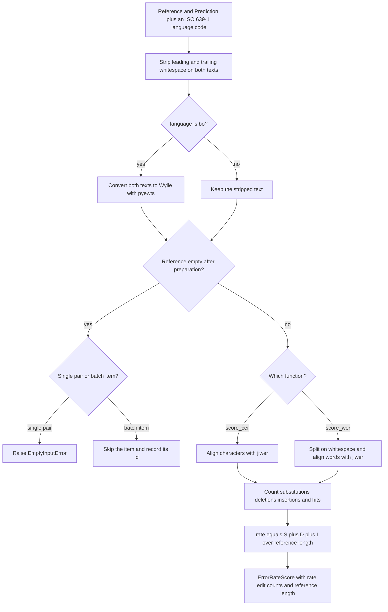
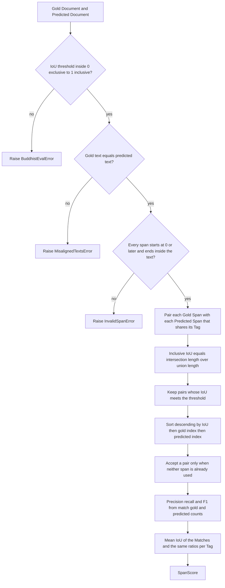

<h1 align="center">
  <br>
  <a href="https://openpecha.org"></a>
  <br>
  buddhist-eval
</h1>

<p align="center">
  CER, WER, and span IoU F1 for Tibetan OCR, speech-to-text, and span annotation.
</p>

<p align="center">
  <a href="#what-it-does">What it does</a> •
  <a href="#who-this-is-for">Who this is for</a> •
  <a href="#install">Install</a> •
  <a href="#character-and-word-error-rate">CER and WER</a> •
  <a href="#span-iou-f1">Span IoU F1</a> •
  <a href="#load-evalai-json">EvalAI JSON</a> •
  <a href="#errors">Errors</a> •
  <a href="#how-to-get-help">Help</a>
</p>

`buddhist-eval` scores a model's output against human ground truth. It is a small Python library: functions take in-memory data and return typed results. There is no CLI and no HTTP service.

Scores stay comparable with the numbers teams already publish. Tibetan text is converted to Wylie before CER and WER, the same way the OpenPecha EvalAI leaderboard does. Span matching follows the quotation-detection evaluator: same tag only, inclusive character offsets, greedy one-to-one matching by IoU.

| Term | Meaning |
| --- | --- |
| Reference | Ground-truth text a human produced for one item. |
| Prediction | Text a model produced for that same item. |
| Gold Span | A labelled character range from the ground truth. |
| Predicted Span | A labelled character range from the model. |
| Tag | The label on a span. A predicted span matches a gold span only when the tags are the same. |
| Language | ISO 639-1 code. `"bo"` converts both texts to Wylie before scoring. |

Domain terms are defined in [GLOSSARY.md](GLOSSARY.md). The Wylie decision is recorded in [docs/adr/0001-tibetan-scored-on-wylie.md](docs/adr/0001-tibetan-scored-on-wylie.md).

## Owner

- [OpenPecha](https://github.com/OpenPecha) (`dev@openpecha.org`)

## What it does

- `score_cer` and `score_wer` score one Reference against one Prediction.
- `score_cer_batch` and `score_wer_batch` score a mapping of item ids and return a per-item mean plus a corpus rate.
- `score_spans` and `score_spans_batch` score Predicted Spans against Gold Spans and return precision, recall, and F1.
- `load_evalai_json` reads the existing EvalAI file shape into the mapping the batch scorers take.

CER and WER are independent. Calling one never computes the other. Scores are unrounded.

## Who this is for

- OCR and speech-to-text researchers who want one CER or WER call, including Tibetan.
- Leaderboard maintainers who need the EvalAI mean, plus a length-weighted corpus rate and a per-item breakdown.
- Annotation researchers who want IoU-matched span F1 outside the quotation-detection training repo.

## Install

Python 3.10 or later. Runtime dependencies are `jiwer` and `pyewts`.

```bash
pip install .
```

For tests and pre-commit:

```bash
pip install ".[dev]"
PYTHONPATH=src pytest
```

## Character and word error rate

Both metrics use the same preparation and the same ratio. The unit changes.

```text
rate = (substitutions + deletions + insertions) / reference_length
reference_length = hits + substitutions + deletions
```

CER counts characters. WER counts whitespace-separated words. For Tibetan, Wylie turns each tsek into a space, so a WER word is a syllable.

### How CER and WER are calculated



An empty Prediction is scored. Every Reference unit is a deletion, so the rate is `1.0`. A Reference id with no Prediction is scored the same way. A Prediction id with no Reference is ignored and listed in `extra_ids`.

### Single pair

```python
from buddhist_eval import score_cer, score_wer

cer = score_cer("བོད་ཡིག", "བོད་སྐད", language="bo")
wer = score_wer("བོད་ཡིག", "བོད་སྐད", language="bo")
```

`བོད་ཡིག` is Wylie `bod yig` and `བོད་སྐད` is `bod skad`. WER is one substitution out of two syllables, so `wer.rate` is `0.5`. `language="en"`, `"fr"`, or any code other than `"bo"` scores the stripped text with no Wylie conversion.

`ErrorRateScore` fields:

| Field | Meaning |
| --- | --- |
| `rate` | CER or WER, unrounded. |
| `substitutions`, `deletions`, `insertions`, `hits` | Edit counts from the alignment. |
| `reference_length` | Characters for CER, words for WER. |

### Batch

```python
from buddhist_eval import score_cer_batch, score_wer_batch

references = {"page-1": "abcd", "page-2": "ef gh"}
predictions = {"page-1": "abxd", "page-3": "extra"}

batch = score_cer_batch(references, predictions, language="en")
# batch.mean    average of each scored item's rate
# batch.corpus  total edits / total reference length
# batch.items   ErrorRateScore per scored id
# batch.skipped_ids  empty References
# batch.extra_ids    predictions with no Reference ("page-3")
```

`mean` gives every scored item equal weight and matches the EvalAI leaderboard average. `corpus` weights long items by their Reference length: total substitutions, deletions, and insertions divided by total Reference length. `score_wer_batch` returns the same shape.

An empty batch, or a batch whose every Reference is empty after preparation, raises `EmptyInputError`. A lone tsek (`"་"`) is empty for Tibetan because Wylie turns it into whitespace.

## Span IoU F1

A `Span` is `start`, `end`, and `tag`. `end` is inclusive, so `(0, 4)` covers five characters. A `Document` is the text plus its spans. Gold and predicted documents must carry the same text, because offsets are character indexes into that string.

A Match is a one-to-one pairing of one Gold Span and one Predicted Span with the same Tag whose intersection-over-union is at least the IoU threshold. The default threshold is `0.5`. It must be in `(0, 1]`.

```text
intersection = overlap of the two inclusive ranges
union        = gold length + predicted length - intersection
IoU          = intersection / union

precision = n_match / n_pred    (0 when n_pred is 0)
recall    = n_match / n_gold    (0 when n_gold is 0)
F1        = 2 * precision * recall / (precision + recall)   (0 when both are 0)
```

### How IoU F1 is calculated



When a document has no Gold Spans and no Predicted Spans, precision, recall, and F1 are `0.0`. `n_gold` and `n_pred` show that case. `mean_iou` is `0.0` when there are no Matches.

### Single document

```python
from buddhist_eval import Document, Span, score_spans

text = "0123456789"
gold = Document(text=text, spans=(Span(0, 4, "quote"),))
predicted = Document(text=text, spans=(Span(0, 4, "quote"),))

result = score_spans(gold, predicted)          # threshold 0.5
# result.f1 == 1.0, result.mean_iou == 1.0

strict = score_spans(gold, predicted, iou_threshold=0.8)
```

`SpanScore` fields: `iou_threshold`, `precision`, `recall`, `f1`, `n_gold`, `n_pred`, `n_match`, `mean_iou`, and `per_tag`. Each `TagScore` repeats precision, recall, F1, and the three counts for one Tag. Tags are every label that appears on either side.

### Batch

```python
from buddhist_eval import score_spans_batch

golds = {"doc-1": gold}
predictions = {"doc-1": predicted, "doc-9": predicted}

batch = score_spans_batch(golds, predictions, iou_threshold=0.5)
```

Counts are pooled across documents before precision, recall, and F1 are computed, so the result is one corpus-level score. A gold id with no predicted document adds its Gold Spans to `n_gold` and contributes no Matches, which lowers recall. Predicted ids with no gold are ignored and listed in `extra_ids`.

## Load EvalAI JSON

The loader accepts a list of `{filename, label}` or `{filename, prediction}` objects, or one such object. `label` is the Reference field and `prediction` is the Prediction field.

```python
from pathlib import Path

from buddhist_eval import load_evalai_json, score_cer_batch

references = load_evalai_json(Path("ground_truth.json"))
predictions = load_evalai_json(Path("submission.json"))
batch = score_cer_batch(references, predictions, language="bo")
```

Duplicate filenames, a missing `filename`, a missing text field, or invalid JSON raise `MalformedEvalAIFileError`. There is no span-file loader: the span API needs the document text, and the quotation gold files do not include it.

## Errors

Every failure raises `BuddhistEvalError` or a subclass. Invalid input is never turned into a score.

| Exception | When |
| --- | --- |
| `EmptyInputError` | Empty Reference on a single pair, an empty batch, or a batch with nothing left to score. |
| `MisalignedTextsError` | Gold and predicted document texts differ. |
| `InvalidSpanError` | A span is negative, ends before it starts, or runs past the text. |
| `MalformedEvalAIFileError` | The EvalAI JSON cannot be read into a filename-to-text mapping. |
| `BuddhistEvalError` | `iou_threshold` is outside `(0, 1]`. |

## Development

```bash
pip install ".[dev]"
PYTHONPATH=src pytest
PYTHONPATH=src pytest --cov buddhist_eval
```

Public entry points live in `buddhist_eval`. Metric logic is in `src/buddhist_eval/core/`. Text preparation and the EvalAI loader are in `src/buddhist_eval/utils/`. Tests call only the public functions.

## Additional documentation

- [GLOSSARY.md](GLOSSARY.md) — Reference, Prediction, CER, WER, Span, Tag, Match, IoU Threshold.
- [docs/adr/0001-tibetan-scored-on-wylie.md](docs/adr/0001-tibetan-scored-on-wylie.md) — why Tibetan is scored on Wylie.
- [docs/help.md](docs/help.md) — where to ask questions.

## How to get help

- File an issue on the [bug tracker](https://github.com/BuddhistAI/buddhist-eval/issues).
- Email openpecha[at]gmail.com.
- Join the [OpenPecha Discord](https://discord.com/invite/7GFpPFSTeA).

## Terms of use

`buddhist-eval` is licensed under the [MIT License](LICENSE).
